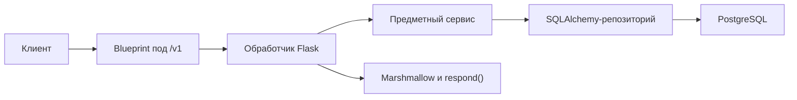

# Архитектура бэкенда Kanwoo

## Запуск и сборка приложения

`manage.py` создаёт Flask-приложение вызовом `create_app(config)`. При локальном запуске его обслуживает Flask, в контейнере `boot.sh` запускает Gunicorn с точкой входа `manage:app`.

`kanwoo/__init__.py` создаёт объекты расширений SQLAlchemy, Flask-Migrate, Flask-Mail, JWT, CORS и Limiter, а также экземпляры LocalStorage и RedisCache. Фабрика в `kanwoo/create_app.py` загружает конфигурацию, инициализирует расширения, передаёт конфигурацию в `AppContainer` и связывает его провайдеры сессии БД, хранилища и кеша с экземплярами приложения. Затем она регистрирует Blueprints, обработчики ошибок и логирование.

`kanwoo/containers.py` собирает контейнеры предметных модулей через `dependency-injector`. Межмодульные зависимости видны в провайдерах. Например, `auth` получает сервис и репозиторий пользователя, `manga` — сервисы модерации и коллекций, а `home` использует закладки, главы и статистику манги.

## Как проходит запрос

`kanwoo/routes.py` регистрирует Blueprints с префиксами API. Декораторы в `auth/middleware.py` и `profile/middleware.py` разрешают пользователя и активный профиль. `profile_required(optional=True)` позволяет обработчику работать с анонимным профилем. Предметные политики отдельно проверяют право на действие над объектом.

Пример записи — `collection/handlers/create_collection_handler.py`. Обработчик загружает JSON через `CreateCollectionSchema`, собирает `CollectionCreateDTO` и вызывает внедрённый `CollectionService`. Сервис использует транзакцию, репозиторий работает с сессией SQLAlchemy, а обработчик сериализует результат через `GetCollectionSchema` и возвращает HTTP 201.

## Общие компоненты в kanwoo/

Компоненты ниже лежат непосредственно в `kanwoo/`. Их можно использовать из предметных модулей. Для каждого компонента указаны реальные потребители или место подключения.

### Хранение данных и транзакции

| Файл | Назначение и использование |
| --- | --- |
| `models.py` | `BaseModel`, общие модели `FileModel`, `Privacy` и `Language`, а также `FileModelMixin`. Здесь же SQL-помощники `page_paginate` и `cursor_paginate`. Методы `BaseModel` работают с общей `db.session`; часть методов умеет делать явный коммит. |
| `repositories.py` | `BaseRepository` принимает сессию и предоставляет поиск по `model.id`, добавление, обновление и удаление. Репозитории коллекций, манги, глав и комментариев расширяют его предметными запросами. Базовые операции изменения сами не коммитят. |
| `database.py` | `DBTransaction` подключён фабрикой в `AppContainer`. Им пользуются, например, сервисы коллекций, глав и профилей. Вложенность учитывается через `ContextVar`: успешный внешний выход коммитит, при исключении выполняется rollback. Вложенный блок не создаёт savepoint. `flush()` отправляет накопленные изменения в БД в рамках транзакции. |
| `unit_of_work.py` | Отдельная реализация со статусом в `ContextVar`. На неё ссылаются обработчик получения URL загрузки и декоратор идемпотентности. В текущем `AppContainer` провайдера `unit_of_work` нет, а реализация не делает явный rollback при исключении из тела блока. |
| `services.py` | `BaseService` хранит профиль. Основные сервисы используют собственные конструкторы с явно переданными зависимостями. |

### HTTP, права и сериализация

| Файл | Назначение и использование |
| --- | --- |
| `utils.py` | `respond()` формирует общий JSON. Успешный ответ содержит `data`, `context`, `metadata`, `permission` и при необходимости `pagination`. Ошибка содержит `error.code` и `error.detail`. |
| `exceptions.py`, `jwt.py` | Фабрика подключает глобальный обработчик API- и HTTP-исключений, включая ошибки лимита запросов, и JWT-обработчики для отсутствующего, недействительного и просроченного токена. `error_handler.py` содержит отдельный обработчик, который фабрика не регистрирует. |
| `permissions.py` | Общие числовые константы ролей. Политики манги, переводов и глав используют их при предметных проверках. |
| `schemas.py`, `entities.py` | Общие поля Marshmallow для файлов и JSON в строке, схемы справочных атрибутов, файловый DTO `File`, преобразование из Werkzeug и общие перечисления. Multipart-поле возвращает DTO, который можно передать сервису обработки или хранения. |
| `middleware.py` | `pagination` извлекает параметры страницы или курсора из запроса. Курсор декодируется из Base64 в JSON. Декоратор используют, например, поиск и уведомления. Декоратор кеширования в этом файле содержит незавершённую реализацию. |
| `frontend_metadata.py` | Общие DTO, схема и интерфейс метаданных страниц. Реализации в `manga` и `chapter` готовят данные, а их обработчики сериализуют результат общей схемой. |

### Внешние сервисы и утилиты

| Файл | Назначение и использование |
| --- | --- |
| `cache.py`, `cache_resolver.py` | `Cache` задаёт интерфейс, `RedisCache` реализует значения с TTL и блокировки на Redis. Фабрика инициализирует кеш по `CACHE_URI`, контейнер передаёт его в `auth`. `CacheResolverMixin` относится к незавершённому декоратору кеширования HTTP. |
| `file_storage.py`, `image.py` | `FileStorageMixin` описывает операции над файлами и URL. Приложение подключает `LocalStorage` по `UPLOAD_DIR` и `CDN_URL`, а для загрузки и чтения оригиналов страниц использует `S3Storage`. `ImageServiceFactory` создаёт сервис Pillow для миниатюр и кадрирования. Контейнер передаёт хранилище и фабрику в `manga`, `chapter` и `profile`. |
| `email.py` | `EmailService` передаётся в модуль `auth`. Отправка через Flask-Mail запускается в отдельном потоке с контекстом Flask. В файле также есть функции для писем восстановления пароля и подтверждения почты. |
| `logs.py`, `uuid.py` | `setup_logs()` настраивает ротацию `app.log` в `LOG_DIR`; `log_runtime` измеряет время вызова. `UUIDGenerator` возвращает строковый UUID v4. |

Для `POST /v1/uploads` задайте `S3_BUCKET_NAME` и `S3_REGION_NAME`. Для S3-совместимого сервиса задайте `S3_ENDPOINT_URL`, доступный браузеру и бэкенду. При необходимости передайте `S3_ACCESS_KEY_ID` и `S3_ACCESS_SECRET_KEY` через окружение. CORS бакета должен разрешать `PUT` и `GET` с origin фронтенда. Для `PUT` разрешите заголовки `Content-Type` и `If-None-Match`. Flask подписывает `PUT` и проверяет объект через `HeadObject`. Читалка получает подписанные `GET`-ссылки на оригиналы. Новые страницы сохраняются по ключу `chapters/{uuid}`. Префиксы `chapters/` и `chapter-originals/` содержат опубликованные страницы и должны находиться вне правил автоматического удаления. Учётной записи S3 нужны `s3:PutObject` и `s3:GetObject` для новых страниц и `s3:GetObject` для ранее опубликованных страниц в `chapter-originals/`.
