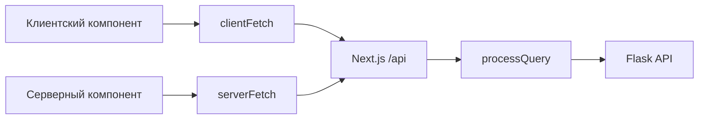

# Архитектура фронтенда Kanwoo

## Точки входа и разметка

Next.js App Router собирает маршруты по файлам в `src/app/`. Группы `(default-layout)` и `(custom-layout)` организуют маршруты по макетам и не добавляют сегменты URL. Компоненты, используемые для сборки общего макета, лежат в `src/app/_components/`.

Корневой серверный `layout.tsx` загружает справочные данные и активный профиль через `metaServerApi` и `profileServerApi`. При ошибке он передаёт провайдерам `null`. Разметку оборачивают провайдеры Material UI и Redux, затем `MetaProvider`, `AuthProfileProvider` и `AppProvider` передают начальные данные в клиентское состояние.

## Путь запроса к Flask

- `src/lib/fetch/client-fetch.util.ts` отправляет относительные запросы в `/api` с cookies браузера. Для запросов с CSRF использует настроенное имя cookie и заголовок `X-CSRF-TOKEN`.
- `src/lib/fetch/server-fetch.util.ts` добавляет cookies текущего серверного запроса. Для относительных путей формирует адрес на основе `NEXT_PUBLIC_SITE_URL` и `/api`. Предметные обёртки лежат в `src/lib/fetch/features/`, например `manga/server.api.ts`.
- `src/app/api/[...parts]/route.ts` передаёт запрос в `processQuery`. В `src/lib/api/api-config.type.ts` настроено соответствие путей и методов. `process-query.ts` выбирает режим `proxy`, `aggregate` или `transform`. `fetchApi.ts` пересылает запрос в Flask по серверному `API_URL`. Агрегирование собирает несколько ответов в один HTTP 200 с полями по именам ресурсов, включая ошибки отдельных запросов.
- `src/proxy.ts` обрабатывает входящие запросы до маршрутов. Он может обновить просроченный access-токен и передать обновлённые cookies дальше. Для страниц добавляет параметр `viewport` на основе User-Agent. Сам маршрут обновления токена исключён из этого перехватчика.

## Состояние и общие компоненты

| Каталог | Назначение и потребители |
| --- | --- |
| `src/features/` | Предметный код, например `catalog`, `manga`, `collection`, `reader` и `studio`. Содержит страницы, компоненты, формы и состояние конкретной области. |
| `src/components/` | Компоненты для повторного использования. Например, `app/AppButton.tsx` используется на странице коллекции, а `poster/PostersStack.tsx` — в карточке коллекции и диалоге добавления манги. |
| `src/lib/state/` | `store.ts` собирает редьюсеры из `features/*/states` и локальных папок Redux. `StoreProvider` создаёт экземпляр хранилища при инициализации. `hooks.ts` экспортирует типизированные хуки Redux. |
| `src/types/`, `src/lib/fetch/` | Общие предметные типы и контракты HTTP. `api-response.types.ts` описывает типы успешных ответов, ошибок и пагинации. |
| `src/hooks/`, `src/utils/`, `src/constants/` | Переиспользуемые хуки, утилиты и константы. Тему Material UI корневой макет импортирует из `src/constants/themes/main.theme.ts`. |
| `src/lib/yandex-oauth/`, `src/lib/yandex-metrica/` | Интеграции с Яндексом. Корневой макет подключает скрипт входа и включает Метрику в production. |
| `public/` | Статические ресурсы, включая логотип, robots.txt и sitemap.xml. |

## Сборка

`next.config.ts` включает `output: "standalone"`. Dockerfile переносит результат сборки, `public/` и `.next/static/` в runtime-образ. Публичные переменные передаются при сборке, серверный `API_URL` — при запуске контейнера. Команды и локальная настройка описаны в [AGENTS.md](../AGENTS.md).
